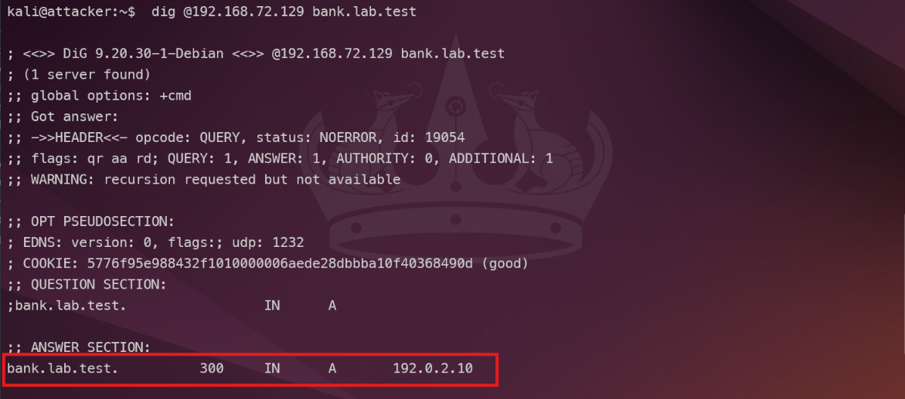
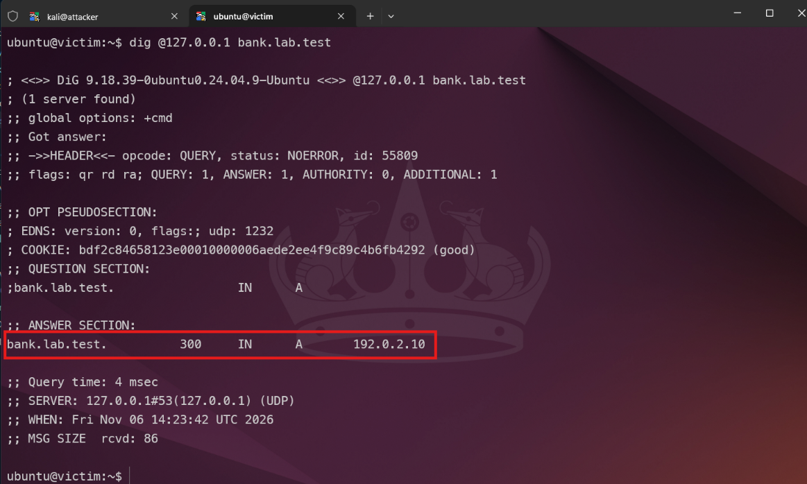
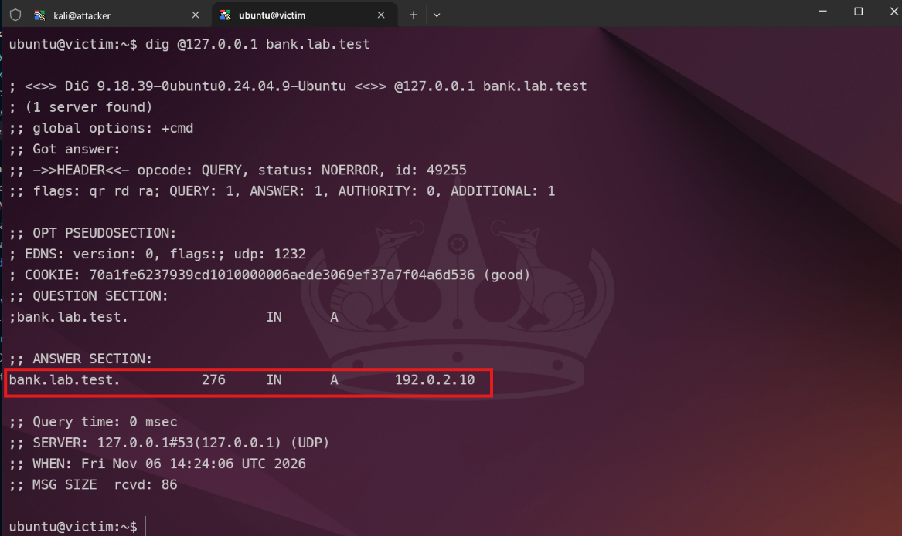
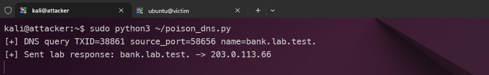
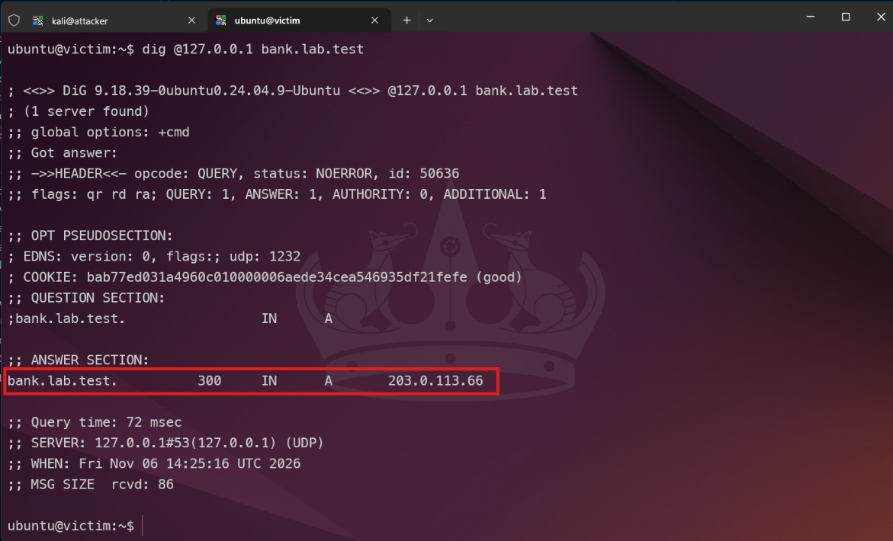

# DNS Cache Poisoning Lab

## Giới thiệu

DNS có nhiệm vụ phân giải tên miền thành địa chỉ IP. Khi người dùng truy vấn một tên miền, DNS resolver tìm câu trả lời từ DNS server phù hợp, sau đó giữ kết quả trong cache theo TTL để phục vụ các truy vấn sau nhanh hơn.

DNS Cache Poisoning xảy ra khi resolver lưu một bản ghi giả vào cache. Khi đó, các truy vấn tiếp theo cho cùng tên miền có thể bị trả về IP sai cho đến khi TTL hết hạn hoặc cache được xóa. Write up này trình bày một lab cô lập gồm hai máy: Kali đóng vai attacker đồng thời là DNS upstream, còn Ubuntu chạy BIND9 caching resolver và mô phỏng victim.

Lab chỉ sử dụng domain `bank.lab.test` và các IP tài liệu. Không truy vấn hay tác động đến DNS công cộng.

## Mô hình lab

| Thành phần | Địa chỉ/Vai trò                                     |
| ---------- | --------------------------------------------------- |
| Kali Linux | `192.168.72.129` - Attacker và BIND9 authoritative  |
| Ubuntu     | `192.168.72.144` - Victim và BIND9 caching resolver |
| Domain lab | `bank.lab.test`                                     |
| IP hợp lệ  | `192.0.2.10`                                        |
| IP giả mạo | `203.0.113.66`                                      |
| TTL        | 300 giây                                            |

Luồng DNS bình thường diễn ra như sau: Ubuntu nhận truy vấn `bank.lab.test`, sau đó forward query đến BIND9 trên Kali. Kali trả về `192.0.2.10`, Ubuntu lưu kết quả vào cache và phản hồi client.

Trong lúc demo, BIND9 hợp lệ trên Kali được tạm dừng. Script Scapy chạy trên Kali quan sát query mà Ubuntu gửi tới cổng UDP/53, lấy transaction ID cùng source port, rồi gửi response giả trỏ domain sang `203.0.113.66`. Nếu response giả được Ubuntu chấp nhận, record giả được lưu trong cache.

## Chuẩn bị môi trường

Project dùng Docker Compose để tạo hai container có systemd. Kali có hostname `attacker`; Ubuntu có hostname `victim`. Terminal mặc định chạy bằng user thường:

| Máy    | User     | Mật khẩu sudo |
| ------ | -------- | ------------- |
| Kali   | `kali`   | `attacker`    |
| Ubuntu | `ubuntu` | `victim`      |

Trên Windows, mở Docker Desktop rồi nhấp đúp `start-lab.cmd`. Project mở hai terminal `kali@attacker` và `ubuntu@victim`.

## Cấu hình DNS

### Kali là DNS upstream hợp lệ

Kali sử dụng BIND9 authoritative cho zone `lab.test`. Cấu hình zone nằm trong `attacker/named.conf.local`:

```conf
zone "lab.test" {
    type primary;
    file "/var/cache/bind/lab/db.lab.test";
    inline-signing yes;
    dnssec-policy default;
    allow-query { any; };
};
```

Bản ghi hợp lệ nằm trong `attacker/db.lab.test`:

```dns
bank IN A 192.0.2.10
```

Do đó, query trực tiếp đến Kali phải trả về IP hợp lệ:

```bash
dig @192.168.72.129 bank.lab.test A +noall +answer
```

Kết quả mong đợi:

```text
bank.lab.test.  300  IN  A  192.0.2.10
```



_Hình 1. Kali BIND9 trả bản ghi hợp lệ `bank.lab.test -> 192.0.2.10`._

### Ubuntu là caching resolver

Ubuntu có forward zone cho `lab.test`:

```conf
zone "lab.test" {
    type forward;
    forward only;
    forwarders { 192.168.72.129; };
};
```

Khi Ubuntu chưa có cache, BIND9 forward query sang Kali. Sau khi nhận response, Ubuntu lưu bản ghi trong cache theo TTL 300 giây.

## Kiểm tra trước khi mô phỏng

Trước tiên, flush cache trên Ubuntu để chắc chắn query sau đó đi ra upstream:

```bash
sudo rndc flushname bank.lab.test
```

Sau đó query resolver trên chính Ubuntu:

```bash
dig @127.0.0.1 bank.lab.test A +noall +answer
```

Kết quả baseline:

```text
bank.lab.test.  300  IN  A  192.0.2.10
```

Chạy lệnh lần thứ hai sau vài giây. TTL giảm chứng tỏ Ubuntu đang trả dữ liệu từ cache:

```bash
dig @127.0.0.1 bank.lab.test A +noall +answer
```



_Hình 2. Ubuntu nhận bản ghi hợp lệ từ resolver cục bộ._



_Hình 3. TTL giảm ở lần truy vấn tiếp theo, xác nhận Ubuntu trả lời từ cache._

## Thực hiện mô phỏng DNS Cache Poisoning

### 1. Xóa cache trên Ubuntu

Trước khi thực hiện, xóa record cũ để Ubuntu phải hỏi upstream ở query tiếp theo:

```bash
sudo rndc flushname bank.lab.test
```

### 2. Tạm dừng DNS hợp lệ và chạy Scapy trên Kali

BIND9 trên Kali cần được tạm dừng để response hợp lệ không đến trước. Lệnh dưới đây chỉ dừng tiến trình BIND9, vẫn giữ địa chỉ và cổng UDP/53 để Scapy phản hồi query:

```bash
sudo kill -STOP $(systemctl show -p MainPID --value bind9)
```

Chạy script Scapy trong home của user Kali:

```bash
sudo python3 ~/poison_dns.py
```

Script lọc DNS query đi từ Ubuntu `192.168.72.144` đến Kali `192.168.72.129`. Khi thấy query `bank.lab.test`, nó giữ lại transaction ID, source port và question section, sau đó tạo response có IP giả `203.0.113.66`.



_Hình 4. Scapy bắt DNS query, đọc TXID và source port, rồi gửi response giả._

### 3. Gửi query từ Ubuntu

Quay lại Ubuntu và thực hiện query:

```bash
dig @127.0.0.1 bank.lab.test A +noall +answer
```

Nếu response giả được chấp nhận, kết quả là:

```text
bank.lab.test.  300  IN  A  203.0.113.66
```

Terminal Kali phải hiện thông tin query và thông báo gửi response giả, ví dụ:

```text
[+] DNS query TXID=... source_port=... name=bank.lab.test.
[+] Sent lab response: bank.lab.test. -> 203.0.113.66
```



_Hình 5. Victim nhận câu trả lời `bank.lab.test -> 203.0.113.66`._

### 4. Xác nhận record giả đã vào cache

Chạy lại query trên Ubuntu sau vài giây:

```bash
dig @127.0.0.1 bank.lab.test A +noall +answer
```

Kết quả vẫn là `203.0.113.66`, nhưng TTL thấp hơn lần đầu. Điều này cho thấy Ubuntu trả lời từ cache; Scapy không cần gửi response cho từng query.


_Hình 6. TTL của record giả giảm, chứng minh record đã được lưu trong DNS cache của Victim._

## Kết quả

| Trạng thái                 | Kết quả query            | Ý nghĩa                                            |
| -------------------------- | ------------------------ | -------------------------------------------------- |
| Bình thường                | `192.0.2.10`             | Ubuntu nhận record hợp lệ từ Kali                  |
| Khi response giả đến trước | `203.0.113.66`           | Ubuntu chấp nhận response giả phù hợp query        |
| Query lặp lại              | `203.0.113.66`, TTL giảm | Record giả được lưu trong cache                    |
| Sau khôi phục              | `192.0.2.10`             | Record giả bị xóa, resolver lấy lại dữ liệu hợp lệ |

Lab chứng minh rằng khi attacker quan sát được query đang chờ, response giả có qname, transaction ID và source port phù hợp có thể được resolver chấp nhận. Các resolver hiện đại dùng transaction ID và random source port để làm việc đoán mù khó hơn. Trong lab này, Scapy quan sát trực tiếp query trong mạng riêng nên có đủ thông tin cần thiết.

## Biện pháp phòng thủ

BIND9 resolver thực tế cần bật DNSSEC validation để từ chối dữ liệu không có chữ ký hợp lệ. Recursive resolver cũng nên giới hạn client được phép query bằng `allow-query` và `allow-recursion`, không mở ra Internet. Quản trị viên cần cập nhật BIND9, theo dõi log DNS và các record có IP/TTL bất thường. Khi nghi ngờ cache bị nhiễm, có thể xóa record cụ thể bằng `rndc flushname` hoặc xóa toàn bộ cache bằng `rndc flush`.

DoT và DoH giúp bảo vệ đường truyền từ client đến resolver, nhưng không thay thế DNSSEC trong việc xác thực dữ liệu DNS.

## Cấu trúc project

```text
dns-cache-poisoning/
├── attacker/              # Kali, BIND9 authoritative và Scapy
├── victim/                # Ubuntu, BIND9 caching resolver
├── compose.yaml           # Mạng LAN, IP tĩnh và systemd
├── start-lab.cmd          # Khởi động trên Windows
├── start-lab.sh           # Khởi động trên Linux
└── README.md
```
